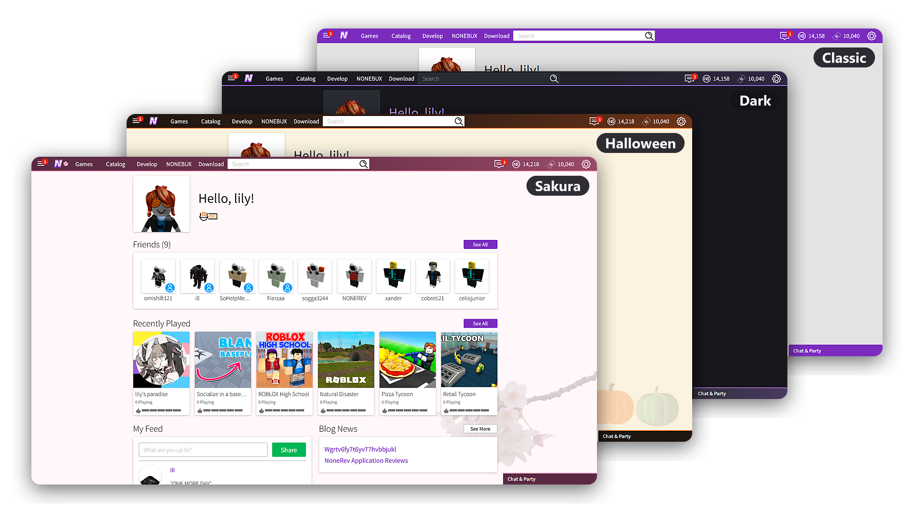

# NoneRev Site Themes

<p align="center">
    
</p>

## Structure

- `css/dark.css` Dark themee :3
- `css/oled.css` pure black 
- `css/halloween.css` it's spooky month!
- `css/sakura.css` Oooh Sakura! So kawaii!
- `assets/` Pictures the css uses, as `../assets/name.svg`
- `examples/custom.css` Some example for your own theme.

Classic theme is just site's default styleish.

## Your own theme

1. Settings > Account info > Site theme: pick classic or dark to build on
2. Settings > Developer: paste your own css, import a `.css` file, give a stylesheet url, or mix them
3. Tick enable custom css and hit save css
4. Test your theme components on `/my/theme-test` and browse around the website too!

It's saved for your account in that browser only, up to 256 KB. The stylesheet url loads after the site theme and the editor css after that.

A stylesheet url has to be https and served as `text/css`. Relative urls inside it load from its own host. In pasted css use full https urls or `/img/themes/...`.

`<html>` has `data-site-theme` (`classic`, `dark`, `oled`, `halloween` or `sakura`) and `data-custom-theme` while yours is on. Dark's colors are variables, so recoloring it is quick:

```css
html[data-site-theme="dark"],
html[data-site-theme="dark"] body {
    --dark-accent: #66c5b4;
    --dark-accent-bright: #a1e6d9;
    --dark-button: #27695e;
    --dark-button-hover: #327c70;
}
```

There is also `--dark-page`, `--dark-surface`, `--dark-surface-raised`, `--dark-border`, `--dark-text`, `--dark-heading` and `--dark-muted`.

Only turn on css you trust, your browser loads whatever urls it points at.

Broke the page? Open `/my/settings?tab=developer&customCss=off`, it switches your css off and keeps it.

## Adding your own theme

Start the file with a header. The site shows it under site theme, so you and the artists get credit:

```css
/*
 * @name Your Theme
 * @author you
 * @description one line about it
 * @credit Picture title by artist, where from (license) https://link
 */
```

One `@credit` per picture, https only please!

Keep everything under `html[data-site-theme="yourtheme"]`, don't move layouts around and leave the warning, error and success colors alone. Check logged in and logged out pages, menus, dialogs, disabled buttons and a phone sized window.

Stuff that bit us:

- Hover. Most bugs only show on hover, like the header settings menu, the catalog category menu and catalog item cards
- `:is(.a::after)` matches nothing, put the pseudo element after it: `:is(.a, .b)::after`
- `overflow` on both `html` and `body` makes the body scroll instead of the page, use `overflow-x: clip`
- The catalog menu is `div#catalog div#dropdown`, overrides need both ids
- A long `:is()` takes the specificity of its heaviest selector
- Some pages paint their own white background, tinted themes have to clear those (see the top of halloween.css)
- Dark sprite icons vanish on dark backgrounds, filter them or ship a recolored copy

## License

AGPL-3.0-only, CC0 from [openclipart](https://openclipart.org)
